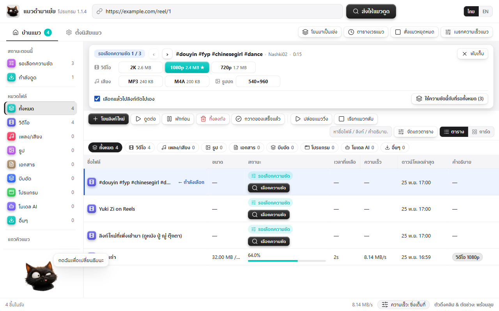
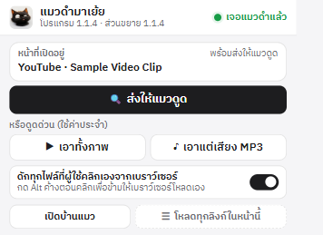
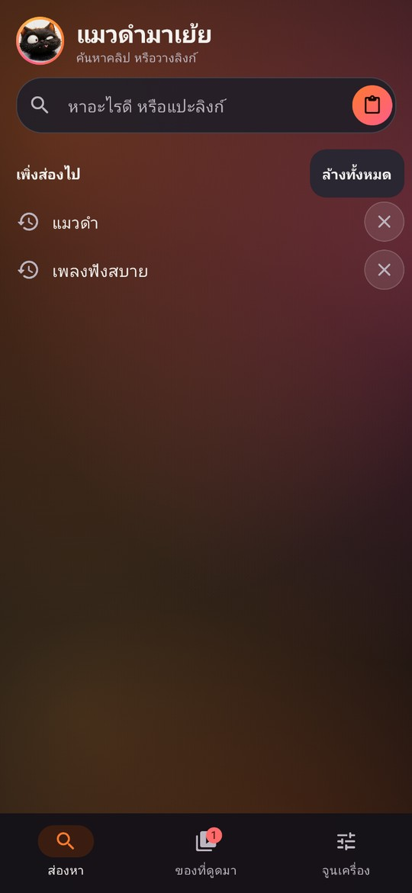

# ศูนย์ดาวน์โหลดเสริม GLee · GLee Extra Download Center

**แมวดำมาเย้ย (GLee Load) ตัวติดตั้งเดียวสำหรับ Windows และแอปมือถือ Android ใช้งานฟรี ไม่มีโฆษณา**  
**Free unified Windows installer for GLee Load and Android mobile app. No ads.**

[ข้อตกลงการใช้งาน (Terms)](TERMS.md) · [ความเป็นส่วนตัว (Privacy)](PRIVACY.md) · [เครดิตชิ้นส่วน (Credits)](CREDITS.md) · [หน้าดาวน์โหลด (Releases)](https://github.com/G-Lee21/glee-download-extra/releases)

---

## รายชื่อโปรแกรม · Applications

<table>
  <tr>
    <td width="96" align="center" valign="top">
      
    </td>
    <td valign="top">
      <h3>แมวดำมาเย้ย (GLee Load) — Windows (โปรแกรม 1.1.4 · ส่วนขยาย 1.1.4)</h3>
      

        โปรแกรมช่วยดาวน์โหลดไฟล์และคลิปโซเชียลความเร็วสูงบน Windows แบ่งหลายท่อน หยุดและโหลดต่อได้ จัดคิว ตั้งเวลา จำกัดความเร็ว รองรับไฟล์ใหญ่จาก Google Drive <strong>คิวเลือกความชัดหลายลิงก์</strong> (`รอเลือกความชัด N / M`, ไม่แย่งแผงที่เปิดอยู่, เลือกแล้วไปลิงก์ถัดไปเอง, ใช้ความชัดเดียวกับที่รอทั้งหมด, กันลิงก์ซ้ำ) ครบ 3 ธีม (ขาว · ดำ · สีรุ้ง) อยู่หน้าเว็บเดิมพร้อมป้ายแมว 1.1 วิ รวมตัวดึงคลิป (<code>yt-dlp</code> + <code>QuickJS-ng</code>), ตัวรวมภาพกับเสียงและตัดช่วง (<strong>FFmpeg รุ่น LGPLv3+ Shared DLL</strong>), เครื่องเล่นในตัวพื้นดำ, ปุ่มโหลดรูปปก, Suno และส่วนขยาย Chrome / Edge (<strong>ส่วนขยาย 1.1.4</strong>) ไว้ในไฟล์ติดตั้งเดียว ลงเสร็จโหลด YouTube และ Facebook Reels ได้ทันที (ไม่มีชิ้นส่วน GPL / AGPL) 
        <em>Fast Windows multi-part download manager and media saver (<strong>App 1.1.4 · Extension 1.1.4</strong>) featuring a multi-link Quality Picker Queue (Waiting N / M, non-hijacking arrivals, auto-advance, Apply to All Waiting, duplicate guard), 3 themes (White · Black · Rainbow), stay-on-page default with 1.1s Cat Toast, user-initiated download catching only, pause/resume, queues, scheduler, speed limiter, Google Drive large-file handling, bundled clip/audio tools (<code>yt-dlp</code>, <code>QuickJS-ng</code>, <strong>LGPLv3+ shared FFmpeg</strong>), built-in media player, cover downloader, Suno support, clip trimmer, and Chrome / Edge <strong>Extension 1.1.4</strong> in one unified installer (zero GPL / AGPL).</em>
      

      

        
        &nbsp;<strong>โปรแกรม 1.1.4 · ส่วนขยาย 1.1.4</strong>
        &nbsp;<code>Windows 10 / 11 (64-bit)</code>
        &nbsp;·&nbsp;<a href="https://github.com/G-Lee21/glee-download-extra/releases/tag/load-v1.1.4">รายละเอียด โปรแกรม 1.1.4 · ส่วนขยาย 1.1.4</a>
      

      

        <strong>วิธีอัปเดตส่วนขยาย:</strong> เปิด <code>chrome://extensions</code> หรือ <code>edge://extensions</code> → กด <code>⟳</code> ที่ส่วนขยายแมวดำมาเย้ย → ต้องขึ้น <strong>ส่วนขยาย 1.1.4</strong> 
        <em><strong>Update extension:</strong> Open <code>chrome://extensions</code> or <code>edge://extensions</code> → click <code>⟳</code> on GLee Load → confirm it shows <strong>Extension 1.1.4</strong>.</em>
      

      

        
<strong>ภาพหน้าจอ · Screenshots</strong>

         
        
          
        
      

      

        รุ่นก่อนหน้า: <a href="https://github.com/G-Lee21/glee-download-extra/releases/tag/load-v1.1.0">โปรแกรม 1.1.0 · ส่วนขยาย 1.1.0</a> · โปรแกรมและส่วนขยายใช้เลขรุ่นเดียวกันเป๊ะทุกรุ่น
      

    </td>
  </tr>
  <tr>
    <td width="96" align="center" valign="top">
      
    </td>
    <td valign="top">
      <h3>แมวดำมาเย้ย (GLee Load) — แอปมือถือ Android</h3>
      

        แอปมือถือ Android สำหรับค้นหาและบันทึกคลิปวิดีโอหรือไฟล์เสียงเก็บไว้ดูแบบออฟไลน์ เลือกความชัดได้เอง ใช้งานง่าย ไม่มีโฆษณา 
        <em>Free, ad-free Android app for searching and saving video or audio clips for offline playback with customizable quality options.</em>
      

      

        
        &nbsp;<code>Android 7.0+ (64-bit / arm64-v8a)</code>
      

      

        
<strong>ภาพหน้าจอ · Screenshot</strong>

         
        
      

    </td>
  </tr>
</table>

> **หมายเหตุ / Note:** ตัวติดตั้ง Windows `GLee-Load-1.1.4-Setup.exe` (**โปรแกรม 1.1.4 · ส่วนขยาย 1.1.4**) พร้อมดาวน์โหลดแล้วในหน้า [Releases](https://github.com/G-Lee21/glee-download-extra/releases) · ไฟล์ `.apk` สำหรับ Android จะเผยแพร่เร็ว ๆ นี้

---

## เครื่องที่ใช้ได้ · System Requirements

| รายการ · Item | รายละเอียด · Details |
|---|---|
| **Windows** | Windows 10 หรือ Windows 11 รุ่น 64-bit (`x86_64`) พร้อม Google Chrome หรือ Microsoft Edge |
| **Android** | Android 7.0 (Nougat) ขึ้นไป แบบ 64-bit (`arm64-v8a`) |
| **บัญชีผู้ใช้ / Account** | ไม่ต้องสมัครสมาชิก ไม่ต้องล็อกอิน · *No account or sign-in required* |

---

## วิธีติดตั้ง · How to Install

### แมวดำมาเย้ยสำหรับ Windows (`GLee-Load-1.1.4-Setup.exe` — โปรแกรม 1.1.4 · ส่วนขยาย 1.1.4) · Windows Unified Installer
1. ดาวน์โหลดไฟล์ `GLee-Load-1.1.4-Setup.exe` จากหน้า [Releases](https://github.com/G-Lee21/glee-download-extra/releases/tag/load-v1.1.4)
2. ดับเบิลคลิกไฟล์เพื่อเปิดหน้าตัวติดตั้งมาตรฐาน GLee แล้วกด **"ติดตั้ง" (Install)** *(หากขึ้น SmartScreen กด "ข้อมูลเพิ่มเติม" → "เรียกใช้ต่อไป")*
3. ลงเสร็จแล้วกด **"เปิดเลย" (Launch)** — สามารถวางลิงก์ไฟล์ทั่วไป, Google Drive, YouTube หรือคลิปโซเชียลแล้วกด **"ส่งให้แมวดูด"** ได้ทันทีโดยไม่ต้องลงส่วนเสริมแยก
4. **ส่วนขยาย Chrome / Edge (ส่วนขยาย 1.1.4):** เปิดแท็บ **"ตั้งนิสัยแมว"** → กดปุ่ม **"พกแมวขึ้น Chrome / Edge"** เพื่อเปิดแฟ้มที่ติดตั้งพร้อมไฮไลต์แฟ้ม `ส่วนขยาย Chrome แมวดำมาเย้ย` จากนั้นเปิด `chrome://extensions` (หรือ `edge://extensions`) → เปิด **"โหมดนักพัฒนาซอฟต์แวร์"** → กด **"โหลดส่วนขยายที่แตกไฟล์แล้ว"** แล้วเลือกแฟ้ม `ส่วนขยาย Chrome แมวดำมาเย้ย`
   - **หากอัปเดตจากรุ่นเดิม:** เปิด `chrome://extensions` หรือ `edge://extensions` → กดปุ่มรีโหลด `⟳` ที่การ์ดส่วนขยาย → ต้องขึ้น **ส่วนขยาย 1.1.4** *(If upgrading: open `chrome://extensions` or `edge://extensions` → click `⟳` on the extension → confirm **Extension 1.1.4**)*

### แอปมือถือ Android (`*.apk`) · Android APK

1. ดาวน์โหลดไฟล์ `GLee-Load-Android-*.apk` จากหน้า [Releases](https://github.com/G-Lee21/glee-download-extra/releases) บนมือถือ Android ของคุณ
2. แตะเปิดไฟล์ `.apk` ที่ดาวน์โหลดมา (จากแถบแจ้งเตือนหรือแอปจัดการไฟล์)
3. หากติดตั้งครั้งแรกนอก Play Store ระบบ Android จะถามสิทธิ์อนุญาตติดตั้งแอปจากแหล่งที่ไม่รู้จัก ให้ทำตามนี้:
   - **ภาษาไทย:** แตะ **"การตั้งค่า"** → เปิดสวิตช์ **"อนุญาตจากแหล่งนี้"** → กดย้อนกลับ → แตะ **"ติดตั้ง"**
   - **English:** Tap **"Settings"** → enable **"Allow from this source"** → go back → tap **"Install"**
4. เมื่อติดตั้งเสร็จ แตะ **"เปิด" (Open)** เพื่อเริ่มใช้งานได้ทันที

---

## วิธีอัปเดต · How to Update

- **Windows:** แอปเช็กรุ่นใหม่จาก GitHub ทุกครั้งที่เปิด ไม่ส่งข้อมูลของคุณ ปิดได้ในตั้งค่า · เมื่อมีรุ่นใหม่กดอัปเดตในแอปได้ทันที พร้อมแถบเปอร์เซ็นต์ ความเร็ว และเวลาที่เหลือ กดยกเลิกได้ ตรวจสอบความถูกต้องด้วย SHA-256 และลายเซ็นดิจิทัล Ed25519 แล้วติดตั้งทับที่เดิมโดย **ข้อมูลและไฟล์ที่ดาวน์โหลดไว้เดิมอยู่ครบ** นอกจากนี้สามารถกดปุ่ม **"อัปเดตตัวดึงคลิป"** ในหน้าตั้งค่าได้ทุกเมื่อ
  - **หลังอัปเดตโปรแกรม อย่าลืมรีโหลดส่วนขยาย:** เปิด `chrome://extensions` หรือ `edge://extensions` → กด `⟳` ที่ส่วนขยายแมวดำมาเย้ย → ต้องขึ้น **ส่วนขยาย 1.1.4**
- **Android:** อัปเดตจากในแอป (ตรวจ SHA-256 ก่อนติดตั้งทับ) หรือดาวน์โหลด `.apk` รุ่นล่าสุดจากหน้า [Releases](https://github.com/G-Lee21/glee-download-extra/releases)

---

## วิธีถอนการติดตั้ง · How to Uninstall

- **Windows:** ไปที่ **Settings → Apps → Installed apps** → เลือก **แมวดำมาเย้ย (GLee Load)** → กด **Uninstall** *(ช่อง "เก็บข้อมูลและการตั้งค่าไว้" ติ๊กเป็นค่าเริ่มต้น และไฟล์ที่ผู้ใช้ดาวน์โหลดไว้จะไม่ถูกลบเด็ดขาด)*
- **Android:** กดค้างที่ไอคอน **แมวดำมาเย้ย** บนหน้าจอโฮม → เลือก **ถอนการติดตั้ง (Uninstall)** *(ไฟล์ในแฟ้ม `Download` ไม่ถูกลบ)*

---

## เอกสารเพิ่มเติม · Documentation

- [ข้อตกลงการใช้งาน · Terms of Use](TERMS.md)
- [นโยบายความเป็นส่วนตัว · Privacy Policy](PRIVACY.md)
- [เครดิตชิ้นส่วนและใบอนุญาต · Third-Party Credits & Licenses](CREDITS.md)
